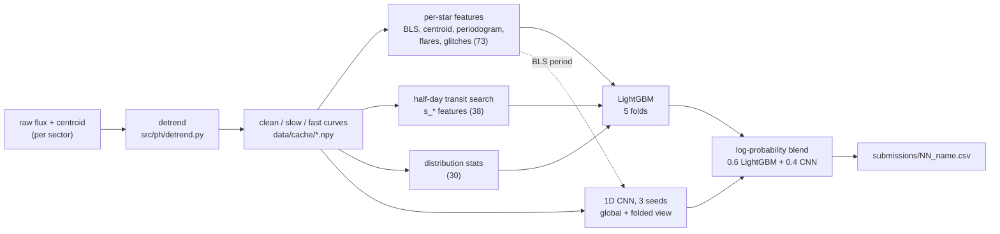
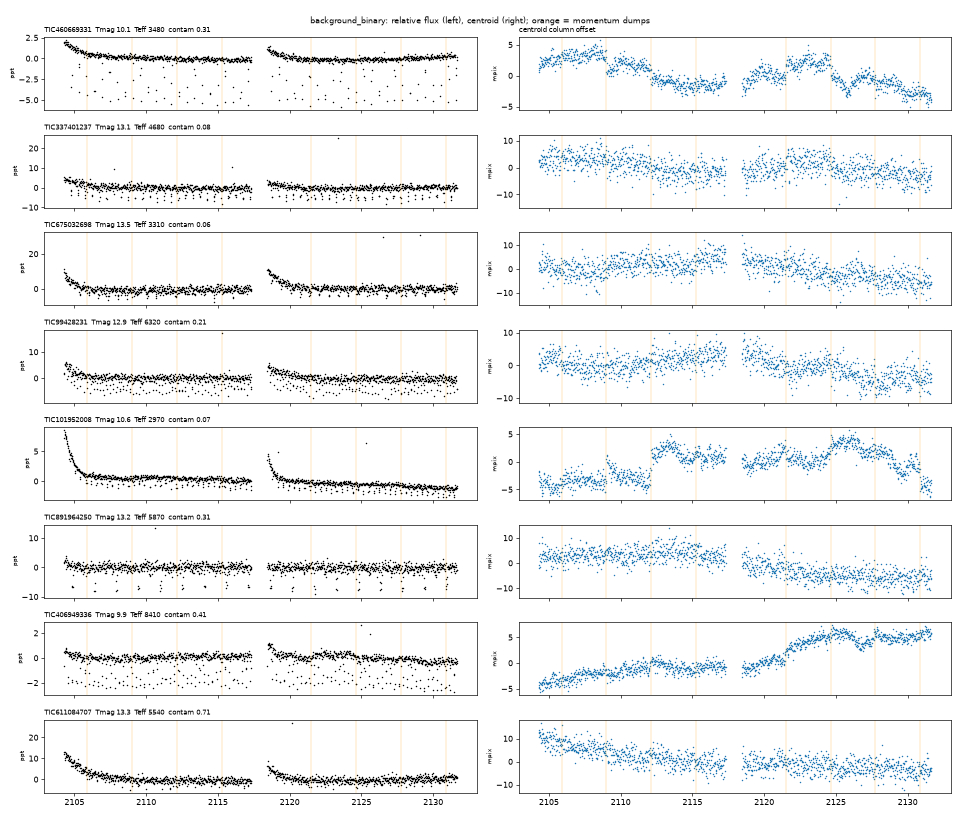

# Planet Hunters: classifying TESS-like light curves

Team Cyclops's solution to **ML Challenge Hack4Hack 2026, Round 1** (22 Oct 2026, 10:00 AM to 23 Oct 2026, 10:00 AM IST): classify 7,000 stars into 8 classes from 27.4 days of brightness and centroid measurements, scored by macro-F1.

The final model blends a **LightGBM** classifier on 139 hand-built astrophysical features (transit search, eclipse vetting, centroid motion, periodograms, flares, glitches) with a **1D CNN** on the raw and phase-folded light curves.

| | Local OOF macro-F1 | Public leaderboard macro-F1 |
|---|---|---|
| Starter-style baseline | 0.549 | not uploaded |
| Best uploaded model (`06_lgbm_v4_cnn.csv`) | 0.7507 | **0.7564** (14th on the live board, 22 Oct, 10:00 PM IST) |
| Last model (`07_lgbm_v6_cnn3.csv`) | 0.7519 | not recorded in the log |

Every upload, its commit and both scores are in [`docs/SUBMISSIONS.md`](docs/SUBMISSIONS.md). Every upload can be rebuilt from the code; see [Reproducing every upload](#reproducing-every-upload).

## Contents

- [The problem](#the-problem)
- [Pipeline at a glance](#pipeline-at-a-glance)
- [1. Detrending](#1-detrending)
- [2. Features](#2-features)
- [3. Models](#3-models)
- [4. Handling the sector shift](#4-handling-the-sector-shift)
- [Results](#results)
- [What did not work](#what-did-not-work)
- [Known limitations](#known-limitations)
- [Reproducing every upload](#reproducing-every-upload)
- [Repository layout](#repository-layout)
- [Shared contracts](#shared-contracts)
- [How we worked](#how-we-worked)
- [Team and acknowledgements](#team-and-acknowledgements)

## The problem

Full statement: [`docs/PROBLEM_STATEMENT.md`](docs/PROBLEM_STATEMENT.md).

Each star has 1,315 brightness readings, one every 30 minutes over one 27.4-day TESS-like sector, plus the column and row position of its light on the camera (the centroid). The task is to predict one label per star:

| Label | What it is | Main clue |
|---|---|---|
| `planet` | A planet transiting the star | Small, regular, flat-bottomed dips of equal depth; no centroid motion |
| `eclipsing_binary` | Two stars eclipsing each other | Deeper, often V-shaped dips; a different-depth secondary eclipse |
| `background_binary` | A faint eclipsing binary blended into the target's light | Planet-sized dips, but V-shaped, odd/even depths differ, **the centroid moves during the dip** |
| `starspots` | Spots on a rotating star | Smooth quasi-periodic dimming over days |
| `pulsating_star` | A pulsating star | Regular oscillations, sometimes faster than the sampling (aliased) |
| `flare_star` | A flaring star | Sudden bright spikes with a slower decay |
| `instrument_glitch` | Detector or pointing problems | Jumps, ramps, sharp dips with a big centroid jump |
| `quiet_star` | Nothing | Noise and common camera trends only |

When a star shows several phenomena, the label is the most important one: `planet` › `eclipsing_binary` › `background_binary` › `pulsating_star` › `flare_star` › `starspots` › `instrument_glitch` › `quiet_star`.

**Data.**

| | Train | Test |
|---|---|---|
| Stars | 18,000 (labelled) | 7,000 |
| Flux | 18,000 × 1,315, float32, electrons/s | 7,000 × 1,315 |
| Centroid | 18,000 × 2 × 1,315, float16, millipixels | 7,000 × 2 × 1,315 |
| Star table | `tmag`, `teff`, `logg`, `radius`, `contamination`, `camera`, `ccd`, `label` | same, without `label` |
| Momentum dumps (`quality & 1`) | 8, every 150 cadences | 10, every 120 cadences |

Training class counts: `quiet_star` 3,624, `starspots` 2,882, `eclipsing_binary` 2,247, `planet` 2,145, `pulsating_star` 1,973, `flare_star` 1,804, `instrument_glitch` 1,721, `background_binary` 1,604.

**What makes it hard.**

- **Sector shift:** train and test come from different sectors, with different pointing, a different thruster rhythm and stronger scattered light in test. This drove most of our design decisions.
- **Weak signals:** many planets sit at the noise level.
- **Look-alikes by design:** background binaries look like planets.
- **Noisy labels:** about 2% of training labels are wrong.
- **Scoring:** macro-F1 makes every class count equally.

**Rules that shaped the code.** Train only on the provided data, with no outside labelled data, no hand-labelling and no pseudo-labelling. The public leaderboard uses 30% of the test stars and the final ranking the other 70%, based on each team's best public upload. Each team gets 5 uploads per day.

## Pipeline at a glance



All models share one fixed split (`folds.csv`: 5 stratified folds, seed 42), and every model writes out-of-fold (OOF) probabilities for the training stars and fold-averaged probabilities for the test stars to `oof/`. Blending is therefore a pure post-processing step.

## 1. Detrending

[`src/ph/detrend.py`](src/ph/detrend.py), run by [`scripts/build_detrended.py`](scripts/build_detrended.py). Everything is computed **within one sector**, so train and test each get their own trends and masks. Only unlabeled test flux is used.

1. **Relative flux:** divide each star by its median and subtract 1. The mid-sector downlink gap (`quality & 4`, cadences 627–679) is set to NaN.
2. **Masks:**
   - momentum dumps (`quality & 1`) plus 1 cadence on each side
   - flagged scattered light (`quality & 2`)
   - **data-driven bad cadences:** a cadence is masked when the median |z| across all stars of the sector exceeds 1.3 × that sector's typical level. In test, scattered light runs to cadences 25 and 708, past the flagged 16 and 695.

   That masks 63 cadences in train and 85 in test, besides the gap.
3. **Common trend per camera/CCD:** for each of the 16 CCDs, take the top 3 principal components of the stars' noise-normalized curves, clipped at ±5σ so that variable stars and transits do not shape the basis. Each star is fitted on `[1, basis]` by least squares over unmasked cadences, with one 4σ clipping pass, and the fitted trend is subtracted. The fits are solved for all stars of a CCD at once via batched normal equations.
4. **Slow / fast split:**
   - `slow`: a 49-cadence (~1 day) running median of the clean curve, which keeps rotation and spots.
   - `fast = clean − slow`: used for dip and flare searches.
5. **Centroids:** remove each star's median, then each CCD's median curve, and apply the same masks.

Runtime on the laptop we used (22 logical cores, on AC power): 4–6 minutes for train and 1.5–3 minutes for test.

## 2. Features

Built by [`scripts/build_features.py`](scripts/build_features.py), in parallel over 20 processes in chunks of 250 stars, into `data/cache/{split}_feat_star.csv` and `{split}_feat_short.csv`. LightGBM adds distribution statistics and the star table at load time ([`scripts/train_lgbm.py`](scripts/train_lgbm.py)), for **139 features** in total after dropping duplicate names.

| Family | File | What it measures |
|---|---|---|
| Transit / eclipse search | [`src/ph/features/transit.py`](src/ph/features/transit.py) | See [transit and eclipse](#transit-and-eclipse) |
| Half-day transit search (`s_*`) | `scripts/build_features.py --short` | The same transit and centroid features on a curve high-passed with a 25-cadence (~0.5 day) running median, durations 0.04/0.08/0.13 d only |
| Centroid motion | [`src/ph/features/centroid.py`](src/ph/features/centroid.py) | See [centroid](#centroid) |
| Variability and frequency | [`src/ph/features/frequency.py`](src/ph/features/frequency.py) | See [variability](#variability) |
| Glitches | `frequency.py` (`glitch_features`) | Largest step between 24-cadence windows, per-orbit noise ratio, level difference and slope difference between the two orbits |
| Distribution statistics | [`src/ph/features/stats.py`](src/ph/features/stats.py) | Noise-normalized spread, extremes, skew, kurtosis, percentiles and 3σ/5σ outlier counts of the clean and fast curves |
| Star properties | `data/*_stars.csv` | `tmag`, `teff`, `logg`, `radius`, `contamination` (`camera` and `ccd` are left out because they are sector-specific) |

### Transit and eclipse
- **Search:** astropy Box Least Squares on the fast curve, with 6,000 periods from 0.4 to 13.7 days (uniform in frequency) and durations of 0.04–0.3 days.
- **Signal strength:** period, duration, depth, depth SNR and periodogram peak height.
- **Vetting:** odd vs even depth, secondary eclipse at phase 0.5, sinusoid-vs-box likelihood, U vs V shape (core depth over full depth).
- **Single events:** the number of transits observed, single-transit dominance, and the deepest single dip at 3, 6 and 12 cadences.

### Centroid
- **In-transit shift:** column and row shift at the BLS ephemeris, with its SNR and the shift per unit depth.
- **Correlation and jumps:** flux–centroid correlation, centroid jump counts, maximum deviation.
- **Pointing steps:** the centroid is levelled separately between momentum dumps, because the pointing steps at every dump.

### Variability
- **Lomb–Scargle on the clean curve (1/13.7–4 c/d):** the top peaks, their power ratios and the harmonic.
- **Lomb–Scargle on the fast curve (1–24 c/d):** the same, with a flag for a peak near Nyquist (aliased pulsators).
- **Shape and amplitude:** autocorrelation at the rotation period, at 1 day and at 1 cadence; slow and total amplitude; skew and kurtosis.
- **Bright excursions:** single-point spikes (cosmic rays) vs runs of 2 or more points above 4σ (flares), and the decay tail after each run.

The half-day search was added after plotting misclassified bright planets. On spotted stars rotating every 1–2 days, the 1-day running median leaves residual wiggles that hide transits. Adding the `s_*` features raised planet F1 from 0.598 to 0.630.

The class gallery ([`scripts/gallery.py`](scripts/gallery.py), [`docs/gallery/`](docs/gallery)) shows 8 random training stars per label. The background-binary page is where the centroid steps at momentum dumps were spotted:



## 3. Models

### LightGBM ([`scripts/train_lgbm.py`](scripts/train_lgbm.py))

| Setting | Value |
|---|---|
| Objective | multiclass, 8 classes, `class_weight="balanced"` |
| Trees | `learning_rate=0.05`, `num_leaves=63`, `min_child_samples=20`, `lambda_l2=1.0` |
| Sampling | `feature_fraction=0.6`, `bagging_fraction=0.8`, `bagging_freq=1` |
| Stopping | up to 3,000 rounds, early stopping after 100 rounds without improvement on the held-out fold |
| Seed / threads | 42 / 8 (all 22 logical cores was slower: thread oversubscription) |
| Runtime | 4–7 minutes for 5 folds |

`--denoise` adds an optional second stage that down-weights training stars whose OOF probability for their own label is below 0.02. `--variability` adds noise-normalized amplitude features. Both are off in every upload from 03 on.

### 1D CNN ([`scripts/train_cnn.py`](scripts/train_cnn.py))

**Two input views plus star properties:**

| Input | Shape | Contents |
|---|---|---|
| Global view | 5 × 1,315, averaged into 2-cadence (1-hour) bins | clean and fast flux ÷ the star's robust noise, high-passed centroid column and row ÷ their noise, valid-data mask; clipped at ±20 |
| Folded view | 3 × 128 | fast flux and both centroids folded on the BLS period into 128 phase bins, rolled so the deepest flux bin is centered |
| Star properties | 7 | `tmag`, `teff`, `logg`, `radius`, `contamination`, log10 noise, log10 BLS period (standardized) |

**Architecture:**
- **Global branch:** 4 blocks with 16, 32, 48 and 64 channels. Each block is 2 × (Conv1d k=5, BatchNorm, GELU) followed by MaxPool(2).
- **Folded branch:** 3 such blocks with 16, 32 and 64 channels.
- **Head:** the mean and max pool of both branches, concatenated with the star properties, go through Linear(263 → 128), GELU, Dropout 0.3 and Linear(128 → 8).

**Training:**
- Cross-entropy with class weights and label smoothing 0.05.
- AdamW with lr 2e-3 and weight decay 1e-2, on a one-cycle schedule.
- Batch size 128, 12 epochs.
- **Augmentation:** random circular time shift of ±60 cadences and 0–9 randomly masked cadence triplets (fake dumps), so the network cannot learn either sector's thruster rhythm.

Runtime: 15–24 minutes per seed on 16 CPU threads. Upload 07 averages three seeds (42, 1, 2) with [`scripts/average_models.py`](scripts/average_models.py).

### Blend ([`scripts/make_submission.py`](scripts/make_submission.py))

The blend is a weighted mean of log-probabilities followed by argmax. The weights come from OOF macro-F1: 0.6 LightGBM and 0.4 CNN. The CNN alone is weaker (OOF 0.689) but makes different mistakes, and the blend adds +0.016 over LightGBM alone. The script validates the file against `sample_submission.csv` ([`scripts/check_submission.py`](scripts/check_submission.py)) and prints the commit hash for the log. Optional per-class offset tuning (`--tune`) exists but was never used in an upload; see below.

## 4. Handling the sector shift

The test sector differs from the training sector in thruster rhythm, pointing and scattered light. [`scripts/adversarial.py`](scripts/adversarial.py) measures how well a LightGBM classifier can tell train stars from test stars using our features. An AUC of 0.5 would mean the two sectors look identical.

| Step | Adversarial AUC | Public score |
|---|---|---|
| First feature set (upload 02) | 0.889 | 0.7085 |
| Mask dumps and scattered light in every curve, detect bad cadences per sector, drop `transit_near_dump_frac` (upload 03) | 0.791 | **0.7243** |
| Additionally apply the union of both sectors' masks to both (upload 04) | 0.701 | 0.7131 |

What caused the drift:
- **`transit_near_dump_frac`:** with more frequent dumps in test, dips land near a dump more often by chance.
- **Bright-tail statistics of the clean curve:** scattered light and dump cadences leaked into them.
- **Periodogram features:** they picked up the dump rhythm.

The union mask made the sectors look most alike, but it scored worse on the public split, so it was dropped. Per-sector masking is the base of every later upload.

From upload 05 on, local OOF and public scores agree within 0.006: 0.7345 vs 0.7359, and 0.7507 vs 0.7564.

## Results

### Per-class OOF F1 (18,000 training stars, 5 folds)

| Model | bg. binary | ecl. binary | flare | glitch | planet | pulsating | quiet | starspots | **macro** |
|---|---|---|---|---|---|---|---|---|---|
| Baseline (`scripts/baseline.py`) | 0.500 | 0.700 | 0.618 | 0.625 | 0.397 | 0.622 | 0.538 | 0.390 | **0.549** |
| LightGBM, first features (02) | 0.716 | 0.805 | 0.736 | 0.850 | 0.609 | 0.822 | 0.695 | 0.606 | **0.730** |
| LightGBM v2, per-sector masks (03) | 0.719 | 0.804 | 0.706 | 0.849 | 0.598 | 0.826 | 0.697 | 0.609 | **0.726** |
| LightGBM v4, + half-day search (05) | 0.728 | 0.803 | 0.710 | 0.854 | 0.630 | 0.828 | 0.706 | 0.617 | **0.734** |
| CNN, 1 seed | 0.669 | 0.789 | 0.723 | 0.857 | 0.557 | 0.681 | 0.645 | 0.591 | **0.689** |
| Blend v4 + CNN (06) | 0.739 | 0.825 | 0.744 | 0.886 | 0.644 | 0.824 | 0.711 | 0.632 | **0.751** |
| LightGBM v6, + centroid levelling | 0.725 | 0.803 | 0.717 | 0.856 | 0.635 | 0.832 | 0.707 | 0.616 | **0.736** |
| CNN, 3 seeds averaged | 0.685 | 0.797 | 0.732 | 0.874 | 0.584 | 0.695 | 0.661 | 0.599 | **0.703** |
| Blend v6 + 3-seed CNN (07) | 0.738 | 0.822 | 0.752 | 0.885 | 0.645 | 0.828 | 0.712 | 0.633 | **0.752** |

Where the errors are (LightGBM v3 OOF confusion): most mistakes are weak signals called `quiet_star`. That covers 473 planets, 758 spotted stars, 334 pulsators and 303 flare stars, plus planets confused with starspots (309) and background binaries with eclipsing binaries (141).

Brightness matters in two ways:
- **Faint stars (Tmag 13.5–15.5):** accuracy drops to 45–61% for six of the eight classes.
- **Bright planets:** only 41% are correct for Tmag below 10, because spot variability on bright stars hides their transits. That's what the half-day search targets.

### Uploads

| File | Model | Local OOF | Public |
|---|---|---|---|
| `01_baseline.csv` | Starter-style statistics | 0.549 | not uploaded |
| `02_lgbm.csv` | LightGBM, 103 features | 0.7300 | 0.7085 |
| `03_lgbm_v2.csv` | + per-sector masking | 0.7261 | 0.7243 |
| `04_lgbm_v3.csv` | + union mask | 0.7291 | 0.7131 |
| `05_lgbm_v4.csv` | v2 + half-day transit search | 0.7345 | 0.7359 |
| `06_lgbm_v4_cnn.csv` | 0.6 LightGBM v4 + 0.4 CNN | 0.7507 | **0.7564** |
| `07_lgbm_v6_cnn3.csv` | 0.6 LightGBM v6 + 0.4 CNN (3 seeds) | 0.7519 | not recorded |

For context, the top of the live public board on 22 Oct, 10:00 PM IST read 0.8309, 0.7998, 0.7977 and 0.7901. Round 1 only decided the top 100 for Round 2, and 54 teams had a score on the board on the evening of 22 Oct.

## What did not work

| Idea | Result | Why we dropped it |
|---|---|---|
| Union of both sectors' masks | OOF 0.7291 vs 0.7261, but public 0.7131 vs 0.7243 | Lowest adversarial AUC, worst public score |
| Down-weighting suspected label errors (`--denoise`) | OOF 0.7305 → 0.7300 | It flagged 6.4% of stars, far more than the stated 2% label noise |
| Per-class log-probability offsets tuned on OOF (`--tune`) | OOF +0.006 | Pushed predicted `quiet_star` on test from 28% to 31%, against 20% in training, so it would amplify the shift |
| Training the CNN for 24 epochs | OOF 0.660 vs 0.689 at 12 epochs | It overfit |
| Noise-normalized amplitude features (`--variability`) | OOF 0.7339 vs 0.7345 | The trees already had this information |
| First CNN size (5 global blocks up to 128 channels, full resolution) | 0.66 s per batch, about 6 h for 5 folds on CPU | Replaced by the lighter network (0.17 s per batch) |

## Known limitations

- **`quiet_star` is over-predicted on test:** 28% of test stars against 20% of training labels. Faint signals still fall into it.
- **CNN reproducibility:** LightGBM runs reproduce exactly. CNN training on CPU with 16 threads is not guaranteed to be bit-identical between machines, so a retrained CNN can differ slightly. The committed `oof/cnn*_*.csv` files are the exact ones used.
- **Early stopping uses the held-out fold**, so OOF scores are slightly optimistic. The public scores track them closely anyway.
- **The scattered-light ramp at the start of each orbit** is only partly removed for some stars and can still create fake signals.

## Reproducing every upload

### Setup

```bash
python -m venv .venv
.venv/Scripts/activate                # Windows; on macOS/Linux: source .venv/bin/activate
pip install -r requirements.txt
```

Versions we used: Python 3.13.7, numpy 2.5.4, pandas 3.0.6, scipy 1.18.1, scikit-learn 1.9.1, LightGBM 4.7.0, astropy 8.0.2, matplotlib 3.11.2. The CNN ran under a separate Python 3.13 with torch 2.13.0+cpu, numpy 2.2.6, pandas 3.0.1 and scikit-learn 1.5.2.

**Data:** the competition files are not in this repo. They came from the organizers' Round 1 download. Put them in `data/`, which is git-ignored:

```
data/train_flux.npy  data/train_centroid.npy  data/train_stars.csv  data/train_cadences.csv
data/test_flux.npy   data/test_centroid.npy   data/test_stars.csv   data/test_cadences.csv
data/sample_submission.csv
```

`folds.csv` is committed. `python scripts/make_folds.py` regenerates it identically.

### The last model (07), from `main`

```bash
python scripts/build_detrended.py                    # data/cache/*_{clean,slow,fast,cen}.npy
python scripts/build_features.py                     # data/cache/*_feat_star.csv
python scripts/build_features.py --short             # data/cache/*_feat_short.csv (see note)
python scripts/train_lgbm.py --name lgbm_v6          # oof/lgbm_v6_*.csv
python scripts/train_cnn.py --name cnn               # seed 42
python scripts/train_cnn.py --seed 1 --name cnn_s1
python scripts/train_cnn.py --seed 2 --name cnn_s2
python scripts/average_models.py --models cnn cnn_s1 cnn_s2 --out cnn3
python scripts/make_submission.py --models lgbm_v6 cnn3 --weights 0.6 0.4 --out 07_lgbm_v6_cnn3
```

Note: for upload 07, the `s_*` features were built before the centroid-levelling commit (`52b4126`). To match it exactly, run `build_features.py --short` at commit `189fcd9` and everything else on `main`.

From the committed `oof/` files alone, the last two commands rebuild `07_lgbm_v6_cnn3.csv` byte-for-byte.

### Earlier uploads

Check out the commit, then run the listed steps. Each one starts with `python scripts/build_detrended.py` and `python scripts/build_features.py` unless noted.

| File | Commit | Steps after detrending and features |
|---|---|---|
| `02_lgbm.csv` | `95dfd54` | `train_lgbm.py` → `make_submission.py --models lgbm --out 02_lgbm` |
| `03_lgbm_v2.csv` | `3aa6fc7` | `train_lgbm.py --name lgbm_v2` → `make_submission.py --models lgbm_v2 --out 03_lgbm_v2` |
| `04_lgbm_v3.csv` | `75509d5` | detrend with `build_detrended.py --union`; `train_lgbm.py --name lgbm_v3` → `make_submission.py --models lgbm_v3 --out 04_lgbm_v3` |
| `05_lgbm_v4.csv` | `189fcd9` | `build_features.py --short`; `train_lgbm.py --name lgbm_v4` → `make_submission.py --models lgbm_v4 --out 05_lgbm_v4` |
| `06_lgbm_v4_cnn.csv` | `fb7ba5b` | as 05, then `train_cnn.py` → `make_submission.py --models lgbm_v4 cnn --weights 0.6 0.4 --out 06_lgbm_v4_cnn` |

### Checks

```bash
python scripts/check_submission.py submissions/07_lgbm_v6_cnn3.csv   # format, ids, labels
python scripts/adversarial.py                                        # train-vs-test AUC and drifting features
python scripts/gallery.py                                            # docs/gallery/<label>.png
```

## Repository layout

```
├── src/ph/
│   ├── data.py              # load_split, load_folds, relative_flux, LABELS, SEED (shared contract)
│   ├── detrend.py           # masks, per-CCD PCA trend removal, slow/fast split
│   └── features/
│       ├── transit.py       # BLS search and transit/eclipse vetting
│       ├── centroid.py      # centroid shift, correlation, jumps; levelling between dumps
│       ├── frequency.py     # periodograms, autocorrelation, flares, glitches
│       └── stats.py         # vectorized distribution and variability statistics
├── scripts/
│   ├── make_folds.py        # folds.csv
│   ├── baseline.py          # starter-style baseline (01)
│   ├── build_detrended.py   # data/cache/*.npy
│   ├── build_features.py    # data/cache/*_feat_{star,short}.csv
│   ├── train_lgbm.py        # LightGBM, oof/<name>_*.csv
│   ├── train_cnn.py         # 1D CNN, oof/<name>_*.csv
│   ├── average_models.py    # mean of several models' probabilities
│   ├── make_submission.py   # blend + format check -> submissions/
│   ├── check_submission.py  # validate a submission CSV
│   ├── adversarial.py       # sector-shift check
│   └── gallery.py           # class gallery images
├── oof/                     # out-of-fold and test probabilities of every model
├── submissions/             # every CSV we built, 01-07
├── docs/
│   ├── PROBLEM_STATEMENT.md # the organizers' statement
│   ├── SUBMISSIONS.md       # upload log: time, commit, local and public score
│   └── gallery/             # 8 example stars per label
├── notebooks/
│   └── starter_notebook.ipynb  # the organizers' starter notebook
├── folds.csv                # 5 stratified folds, seed 42
├── AGENTS.md                # rules for anyone (human or agent) working in the repo
└── requirements.txt
```

## Shared contracts

- **Folds:** `folds.csv` has columns `id,fold`, with 5 stratified folds and seed 42. Every model uses it, which is what makes OOF blending valid.
- **Model outputs:** `oof/<model>_oof.csv` (18,000 training rows) and `oof/<model>_test.csv` (7,000 test rows). The columns are `id` plus one probability per label, in sorted label order.
- **Submissions:** `submissions/NN_<name>.csv` has columns `id,label`, one row per test star. Each upload is logged in `docs/SUBMISSIONS.md` with its commit.
- **Seeds:** 42 everywhere, except the extra CNN seeds 1 and 2.

## How we worked

- **One GitHub issue per task**, using the Task template in `.github/ISSUE_TEMPLATE/task.yml`: goal, acceptance criteria, scope, files not to touch.
- **One branch and one PR per issue.** Branches are named `type/issue-number-short-description`, and commits follow `type: short description`.
- **No direct pushes to `main`.** The detailed rules for humans and coding agents are in [`AGENTS.md`](AGENTS.md).

## Team and acknowledgements

**Team Cyclops:** Jey Pranav ([@Pranav-0710](https://github.com/Pranav-0710)) built the solution. Goutam Adityan was on the registered team but unavailable during the round.

**Thanks** to the Hack4Hack organizers for the problem, the TESS-like dataset and the starter notebook.

The repository has no license file yet. The competition data is not redistributed here.
